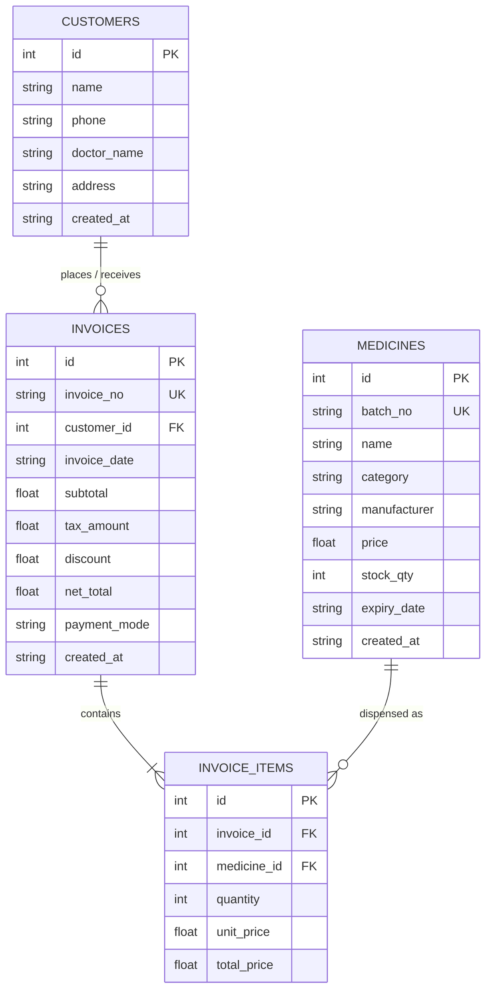

# PharmaCare — Medical Store Billing & Inventory Management System

**Course Practical:** Program No. 30 (MAJOR PROJECT – II)  
**Aim:** To develop a complete desktop application with a graphical user interface and SQLite database integration using Python (Tkinter/ttk) and AI coding assistants, including file handling, report generation, and a distributable build of the application.

---

## 📌 Project Overview
**PharmaCare** is a production-grade desktop Point-of-Sale (POS), Medicine Inventory, and Billing system tailored for retail pharmacies and clinics. Built with Python 3, Tkinter, and an embedded SQLite database engine, it provides real-time stock tracking, automated GST/tax calculation, itemized invoice generation, export/import file utilities, and executive sales analytics.

---

## 🌟 Key Specifications & Compliance Checklist

| Specification Requirement | Implementation in PharmaCare | Status |
| :--- | :--- | :---: |
| **Theme Selection** | Medical Store Billing & Inventory System | ✅ Completed |
| **GUI Framework** | Python Tkinter + ttk with modern custom styling and Menu Bar | ✅ Completed |
| **Screens / Forms** | **5 Screens**: POS Billing, Inventory CRUD, Customer Directory, Invoices History, Reports & Analytics | ✅ Completed (5 / $\ge 4$) |
| **SQLite Database** | **4 Relational Tables**: `medicines`, `customers`, `invoices`, `invoice_items` with Foreign Keys | ✅ Completed (4 / $\ge 3$) |
| **CRUD Operations** | Complete Create, Read, Update, Delete with form validation and confirmation modal on delete | ✅ Completed |
| **Search & Filtering** | Live multi-field search (Name, Batch, Phone, Payment mode) + Category filter | ✅ Completed |
| **Report Generation** | KPI metric cards + Category-wise turnover table + Low-stock alert table | ✅ Completed |
| **File Handling** | CSV export/import (Medicines), JSON export (Sales), Formatted Text receipt export (.txt) | ✅ Completed |
| **Distributable Build** | Standalone Windows executable (`PharmaCare.exe`) generated via PyInstaller | ✅ Completed |
| **AI Prompt History** | Comprehensive prompt evolution log included in documentation | ✅ Completed |

---

## 🗄️ Relational Database Architecture



---

## 🖥️ Screen Modules & Screenshot Guide

Each screen is available as both an embedded module in the main app and an independent standalone script for straightforward screenshot capture:

### 1. Screen 1: POS Billing & Cash Register Terminal
- **File:** `screen1_billing.py` (or navigate via Main Sidebar: *POS Billing*)
- **Command to run standalone:**
  ```bash
  python screen1_billing.py
  ```
- **Features:** Customer selector, fast medicine search with real-time stock badge, quantity spinner, interactive billing cart, automatic GST (12%) and discount calculation, instant checkout, and automatic generation of printable `.txt` receipts.

### 2. Screen 2: Medicine Inventory & Stock Control
- **File:** `screen2_inventory.py` (or Main Sidebar: *Medicine Inventory*)
- **Command to run standalone:**
  ```bash
  python screen2_inventory.py
  ```
- **Features:** Complete CRUD table for medicines, input validation (price $> 0$, stock $\ge 0$, valid date), confirmation modal before deletion, category dropdown filtering, CSV stock export and bulk CSV stock import.

### 3. Screen 3: Customer & Patient Directory
- **File:** `screen3_customers.py` (or Main Sidebar: *Customer Directory*)
- **Command to run standalone:**
  ```bash
  python screen3_customers.py
  ```
- **Features:** Patient and customer record keeping, doctor tracking, search by customer name/phone/doctor, edit and delete with confirmation dialog.

### 4. Screen 4: Sales Invoices History & Receipt Management
- **File:** `screen4_invoices.py` (or Main Sidebar: *Invoices History*)
- **Command to run standalone:**
  ```bash
  python screen4_invoices.py
  ```
- **Features:** Master-detail split view of past invoices, payment mode filter (Cash / UPI / Card), itemized medicine breakdown table, reprint/save text receipt (`.txt`), export all transactions to JSON, and void/delete invoice with automatic stock rollback to inventory.

### 5. Screen 5: Reports & Business Analytics
- **File:** `screen5_reports.py` (or Main Sidebar: *Reports & Analytics*)
- **Command to run standalone:**
  ```bash
  python screen5_reports.py
  ```
- **Features:** Live KPI cards (Gross Revenue, Total Invoices, Total Medicines, Total Stock Units, Low Stock Warnings), Category-wise revenue table, Low-stock reorder table, and CSV report export.

---

## 🚀 Running the Main Application

To start the unified multi-screen application with the top Menu Bar and sidebar:
```bash
cd "c:\Vibe Coding Practicals\Practical_30"
python main.py
```

---

## 📦 Distributable Executable (`.exe`)

The application is compiled into a standalone Windows executable using PyInstaller.
- **Location:** `Practical_30/dist/PharmaCare.exe`
- **Build Command Used:**
  ```bash
  python -m PyInstaller --onefile --windowed --name="PharmaCare" main.py
  ```

---

## 🤖 List of AI Prompts Used

The following AI prompts were engineered and iterated to design, develop, test, and package this application:

1. **Architecture & Schema Prompt:**
   > *"Design a robust SQLite schema for a retail Pharmacy Management & Billing desktop application using Python. Include 4 normalized tables: medicines, customers, invoices, and invoice_items with proper foreign keys, constraints, and cascade relationships. Provide an initial seed dataset with real medicines, prices, batches, and sample sales transactions."*

2. **Database Engine & File Handling Prompt:**
   > *"Write a clean Python DatabaseManager class for SQLite implementing: context-managed connections, complete CRUD for medicines and customers, multi-item invoice transactions with automatic stock decrementation, JSON export of invoices, CSV import and export for medicines, and a printable text receipt generator."*

3. **Multi-Frame Main Window & Navigation Prompt:**
   > *"Create a modern Tkinter desktop application shell featuring a top native Menu Bar (File, Inventory, Billing, Customers, Reports, Help) and a sleek left sidebar with active tab highlighting. Implement frame-switching logic for 5 modular screens with high-DPI scaling support."*

4. **POS Billing Terminal Prompt:**
   > *"Build a POS Billing Screen in Tkinter that allows selecting a customer, searching medicines with stock status badges, adding items to an in-memory cart with quantity validation, calculating subtotal, 12% GST, and discount, and completing checkout to record an invoice."*

5. **Inventory & Customer CRUD Prompt:**
   > *"Develop full CRUD management screens for Medicines and Customers in Tkinter using ttk.Treeview. Include search filters, category selectors, form validation with alerts, confirmation dialogs (askyesno) before deletion, and make each screen runnable as a standalone application."*

6. **Reports & Analytics Prompt:**
   > *"Implement an executive analytics dashboard screen in Tkinter with KPI stat cards (Revenue, Invoices, Stock Units, Low Stock) and two notebook tabs displaying category-wise revenue aggregation and a low-stock re-order alert table."*

7. **Packaging & PyInstaller Prompt:**
   > *"Package the Tkinter application into a single self-contained Windows executable (.exe) using PyInstaller without a console window, ensuring file paths resolve relative to sys.executable when running frozen."*

---

## 📂 Deliverable Files Included in Repository
- `main.py` — Main multi-screen application entry point
- `database.py` — SQLite database engine and file handling layer
- `screen1_billing.py` — POS Cash Register & Billing Terminal
- `screen2_inventory.py` — Medicine Inventory CRUD & CSV I/O
- `screen3_customers.py` — Customer Directory CRUD & Search
- `screen4_invoices.py` — Sales Invoices History & Receipt Viewer
- `screen5_reports.py` — Reports & Business Analytics
- `pharmacare.db` — SQLite database file populated with sample records
- `medicines_inventory.csv` — Exported sample CSV inventory data
- `invoices_history.json` — Exported sample sales transactions JSON
- `receipt_INV-2026-0001.txt` — Exported sample text receipt
- `category_sales_report.csv` — Exported category performance CSV report
- `dist/PharmaCare.exe` — Standalone distributable executable
